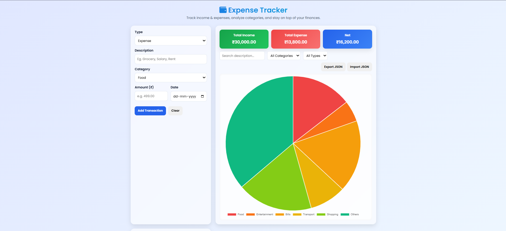
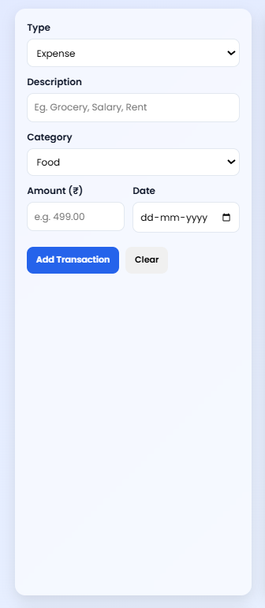
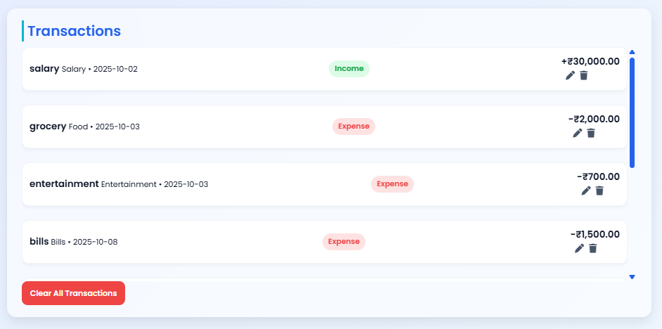
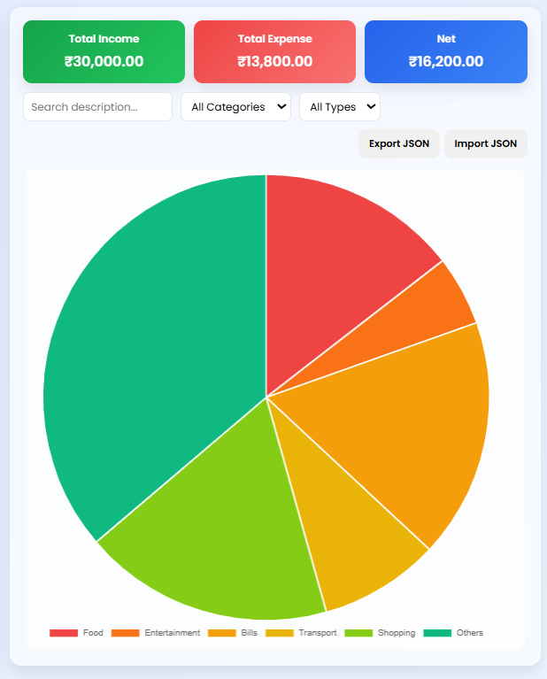

# 💰 Expense Tracker Web App

🔗 **GitHub Pages Live Demo:** [https://hritik200.github.io/Expense_Tracker/](https://hritik200.github.io/Expense_Tracker/)  
▲ **Vercel Live App:** [https://expense-tracker-tau-bice-71.vercel.app/](https://expense-tracker-tau-bice-71.vercel.app/)  

## 📘 Project Overview
The **Expense Tracker App** is a luxury, responsive, enterprise-grade financial management web application.  
Built using modern **HTML5, CSS3, and modern ES6+ JavaScript**, it provides full offline-ready budgeting, interactive 3D virtual cards, financial wellness scoring, recurring subscriptions tracking, and multi-currency exchange.  
Data is stored securely in the browser’s **localStorage**, ensuring complete privacy and immediate persistence without backend dependencies.  
The app features dynamic interactive charts via **Chart.js** (Category Breakdown, Cashflow Comparison & Trend Trajectory), monthly budget tracking, CSV/JSON export, live currency conversions, and seamless Light/Dark mode.

---

## 🎯 Objectives
- To create an interactive and user-friendly financial tracker.  
- To implement **CRUD operations** using JavaScript.  
- To use **localStorage** for persistent data management.  
- To display **real-time summaries and charts** for better analysis.  
- To design a clean, professional, and responsive user interface.

---

## ⚙️ Technologies Used
| Technology | Purpose |
|-------------|----------|
| **HTML5** | Structure and layout |
| **CSS3** | Styling and responsiveness |
| **JavaScript (ES6)** | App logic and interactivity |
| **Local Storage** | Persistent data |
| **Chart.js** | Expense distribution chart |
| **Font Awesome** | Icons for better UI |
| **Google Fonts (Poppins)** | Typography |
| **VS Code** | Development environment |

---

## 🧠 Features
✅ **Interactive 3D Virtual Platinum Card**: Dynamic card balance sync with 3D mouse tilt and 4 themes (Obsidian, Royal Indigo, Cyber Emerald, Sunset Rose)  
✅ **Financial Wellness Score Gauge (0-100)**: Real-time algorithm assessing savings ratio, budget discipline, and safe daily burn rate  
✅ **Quick Action Dock**: Rapid launcher for Add Expense, Add Income, Manage Bills, Split Expenses, Currency Exchange, and Savings Goals  
✅ **Live Currency Exchange Converter**: Instant multi-currency conversions with exchange rate table and 1-click swap  
✅ **3 Real-World Demo Scenarios**: 1-click loading for Tech Professional, Freelancer, and Student personas  
✅ **Category Spending Distribution Meters**: Top expense categories visualized with progress meter bars  
✅ **CRUD Operations**: Add, Edit (via sleek modal dialog with payment mode & notes), and Delete Transactions  
✅ **Smart Financial Insights Ticker**: Automated insights highlighting top expense category, monthly budget health, and largest purchases  
✅ **Global Command Palette (`Ctrl + K` / `⌘K`)**: Quick-jump search and instant actions launcher across all features  
✅ **Recurring Bills & Subscriptions Manager**: Track monthly recurring burn (Netflix, Gym, Wifi, Rent) with 1-click "Mark Paid Today" logging  
✅ **Split Bill & Group Expense Calculator**: Calculate share per person with tip/tax and auto-generate WhatsApp share summaries  
✅ **Multi-Currency Support**: Switch on-the-fly between **₹ INR**, **$ USD**, **€ EUR**, **£ GBP**, **¥ JPY**, **C$ CAD**, **A$ AUD**, and **AED**  
✅ **Customizable Theme Accents**: Choose between **Indigo**, **Emerald**, **Violet**, and **Rose** color palettes  
✅ **Bulk Selection & Actions**: Multi-select transactions to bulk delete or export selected entries to CSV  
✅ **Savings Goals Manager**: Set savings targets (Emergency Fund, Vacation, Gadgets) with progress tracking and 1-click fund deposits  
✅ **Financial Health Metrics**: Auto-calculates your **Savings Rate %** and **Daily Average Spend**  
✅ **Payment Method Tracking**: Tag payments by **UPI / Online**, **Credit Card**, **Debit Card**, **Cash**, and **Net Banking** with custom icons and filters  
✅ **3-Way Interactive Analytics (Chart.js)**: Toggle between **Expense Category Doughnut**, **Monthly Cashflow Bar Chart**, and **Cumulative Balance Trend Area Chart**  
✅ **Date-Grouped Transaction View**: Switch between **Grouped by Date** (with daily net subtotals) and clean **Flat List**  
✅ **Print & PDF Financial Statement**: 1-click formal Financial Statement generator optimized for paper print or saving to PDF  
✅ **Dark & Light Mode**: Seamless theme switching with system detection and Local Storage persistence  
✅ **Monthly Budget Planner**: Set monthly budget goals with progress bar alerts (Safe $\rightarrow$ Warning $\rightarrow$ Exceeded)  
✅ **Keyboard Shortcuts**: Fast navigation with `Ctrl+K` (Command Palette), `N` (New), `B` (Budget), `S` (Savings Goals), `P` (Print), `T` (Theme), `/` (Search), and `?` (Help)  
✅ **Export & Import**: Export directly to **CSV** (for Excel/Google Sheets) and **JSON**, with JSON restore support  
✅ **Mobile Floating Action Button (FAB)**: Quick-access add button for comfortable single-thumb mobile usage  
✅ **Universal Device Compatibility**: 100% responsive across mobile phones (touch targets $\ge 44\text{px}$), tablets, laptops, and ultra-wide screens  

---
## 🖼️ Screenshots

1. Home Page 
   

2. Transaction form 
   

3. Transaction Table
   

4. Expense chart view
   

---

## ▶️ How to run the project

- **Open directly:** double-click `index.html` to open it in your browser (no build step required).

- **Recommended (VS Code):** install the **Live Server** extension, then right-click `index.html` → _Open with Live Server_.

- **Using a simple server:**
  - Python: `python -m http.server 8000` → open http://localhost:8000
  - Node: `npx http-server` → open the printed URL (or install `http-server` globally and run `http-server`)

